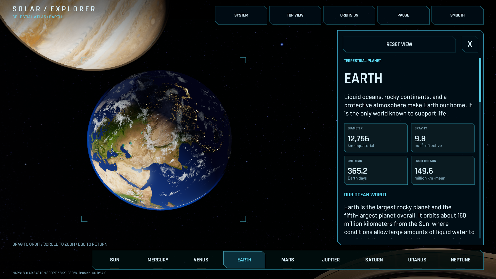
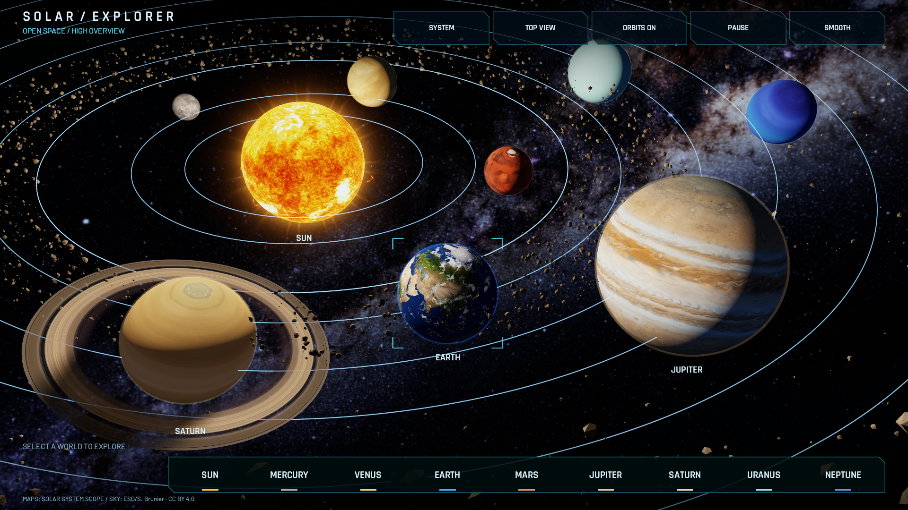
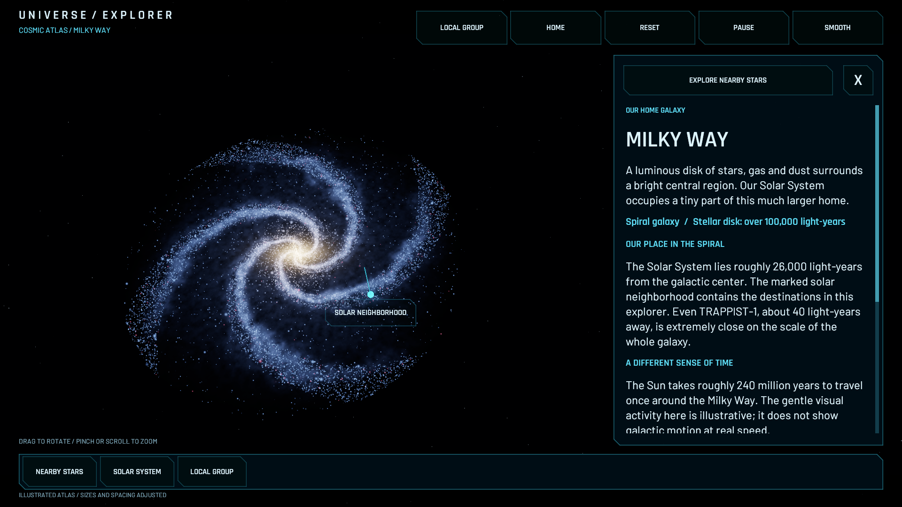
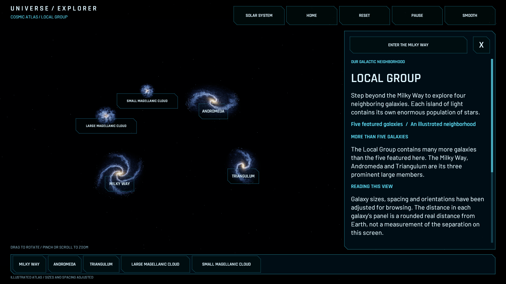
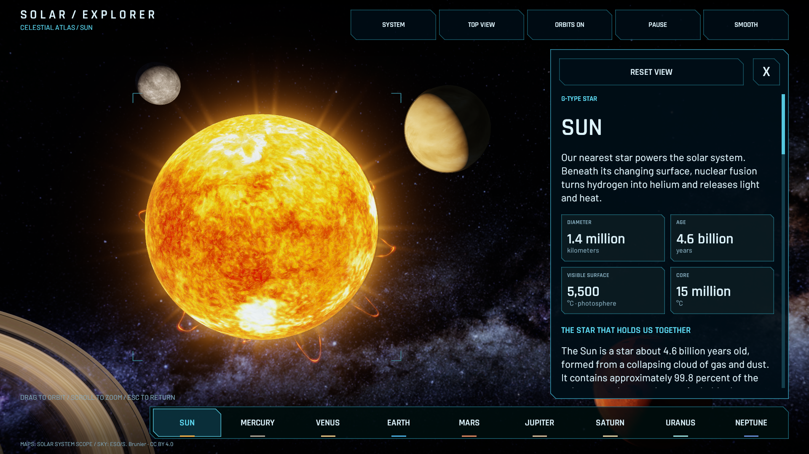
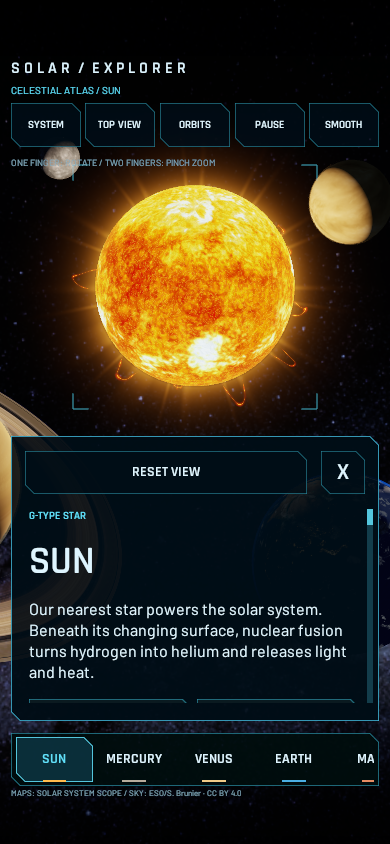
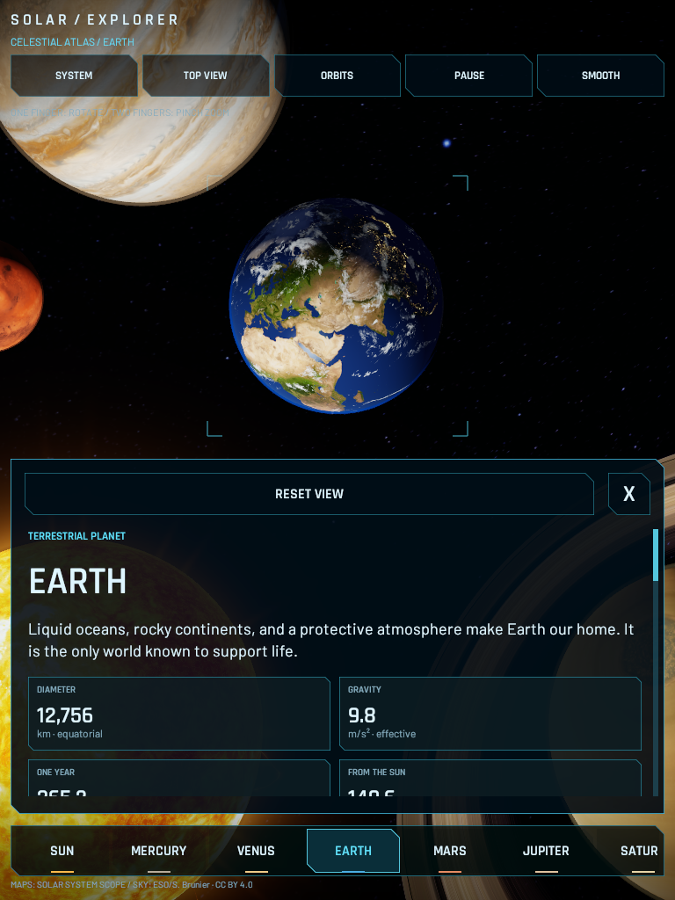

# Solar System Explorer

A small Unity 6 project for exploring the Sun and eight planets in our solar system from a cinematic high overview. Larger mapped planets, a warm solar corona, glowing orbital guides, and a drifting asteroid belt sit against the Milky Way. Tap or click a world, glide into a close view, and explore its surface while reading a substantial NASA-based article. The scrollable information panel sits beside the world in landscape and below it in portrait.

The **Galaxy** button opens an illustrated cosmic atlas: the Milky Way, a local stellar neighborhood with TRAPPIST-1 and Proxima Centauri, and a Local Group view with four neighboring galaxies. The seven TRAPPIST-1 planets and Proxima b support the same touch orbit, pinch zoom, reset, and scrollable articles as the original planets. Their surfaces are original artistic interpretations of confirmed worlds.

## Open and play

1. Install **Unity 6.3 LTS, 6000.3.22f1**, through Unity Hub. The [release page](https://unity.com/releases/editor/whats-new/6000.3.22f1) links the installer. This is the pinned project version; newer Unity 6 versions may prompt an upgrade and need revalidation.
2. In Unity Hub, choose **Add project from disk** and select this `SolarSystemExplorer` folder (the folder containing `Assets`, `Packages`, and `ProjectSettings`). Open the supplied project; no new project template is needed.
3. Allow the first package import to complete. The only additional package is Unity UI, resolved through Unity's package registry.
4. Open `Assets/SolarExplorer/Scenes/SolarSystem.unity`, or use **Solar Explorer > Open Solar System**.
5. Press **Play**. The scene creates its planets, camera, stars, and UI at runtime. A mostly empty Scene view before Play is expected.

Use the **Built-in Render Pipeline** already implied by this project. The included custom shaders are not URP/HDRP shaders. The input setting is **Input Manager (Old)**; there is no dependency on the new Input System package. If importing into another project instead, preserve these settings.

## Included

- Mercury, Venus, Earth, Mars, Jupiter, Saturn, Uranus, and Neptune, plus a selectable Sun with its own article and star-specific statistics.
- A close, deliberately composed 60-degree overview and a full-system top view. All eight planets remain selectable, with larger foreground worlds and orbital arcs extending beyond the screen. The initial composition targets a 16:9 window and adjusts for phone and tablet aspect ratios, including portrait.
- Full-resolution 4K/8K surface and cloud maps where provided, Earth terrain normals and ocean reflections, cloud shadows, atmospheric scattering, Saturn ring shadows, linear lighting, and restrained HDR bloom. The Sun rotates with a churning, distorted surface texture, a compact corona, and twelve evolving magnetic prominence loops. The loops grow, fade, and carry animated plasma highlights. Uranus and Neptune retain the provider's 2K maps.
- Visible idle rotation on every planet and independent drift and tumbling for 3,400 asteroids. Rotation and orbital speeds are illustrative. A shared animation clock makes Pause stop the complete ambient scene.
- Desktop BC7 texture compression, sharper mip filtering, 16× anisotropic filtering, and filmic highlights preserve detail. The scene is rendered at the Game view/player resolution; only the bloom buffer is blurred. There is no depth-of-field or motion blur. iOS and Android texture overrides use ASTC 6×6 with a 4K cap; desktop maps retain their existing resolution.
- A photographic 6000 × 3000 Milky Way panorama by ESO/S. Brunier, with a separate layer of soft stellar glints. Source photographs, procedural effects, and 3D geometry are rendered live; the concept mockup is not used as a flat background.
- A mesh of 3,400 irregular asteroids, including foreground debris, slow cloud movement, and subtle traveling highlights on the orbital guides. Hover a world or its navigation button to highlight its guide and show targeting brackets.
- Earth cloud and night-light maps, atmospheric rims, and textured Saturn rings with a planetary shadow.
- Saturn opens in a closer, sunlit three-quarter view fitted to the projected ring ellipse. Its flattened globe has enhanced cloud-band contrast and subtle moving cloud detail; the rings have finer geometry, neutral ice tones, and light transmission. The supplied Saturn surface is 4096 × 2048 despite the provider's `8k_saturn` filename; its ring profile is 8192 pixels wide. Both retain their source resolution on desktop.
- Tap/click a sphere, its name, or a bottom navigation button to focus it. The Sun is the first navigation entry. Swipe the navigation strip on narrow displays to reveal the remaining worlds.
- Eased camera flights, damped scroll zoom, and left- or right-button drag to orbit a selected planet. The overview stays fixed at its chosen high/top angle. Camera travel locks gestures, selection, buttons, keyboard shortcuts, and article scrolling until arrival.
- An original sci-fi HUD with a slim navigation bar, cut-corner glass panels, cyan targeting marks, Rajdhani headings, Barlow body text, compact statistics, and source links. The Sun, Earth, Jupiter, and Saturn have permanent overview labels; other names appear on hover.
- Pause/resume animation and an instant-camera option. Orbital guides and asteroids fade away during close-up travel and return with the overview.
- Git ignore rules and stable Unity `.meta` files, with project assets and settings under version control.

## Controls

- **Tap / click:** select the Sun, a planet, its label, or a navigation button. Selecting another visible body works while already focused on one.
- **One-finger drag / left- or right-mouse drag over space:** orbit the selected world once the camera has arrived. The overview cannot be dragged or zoomed.
- **Pinch / mouse wheel over space:** zoom. In a focused view, zooming out stops at the initial viewing distance; zooming in has a safety limit.
- **Reset View:** smoothly restore the selected world's original angle and distance.
- **X / System / Esc / Home:** return to the overview. The X stays visible while the article scrolls.
- **Swipe / wheel over the article:** scroll the information without moving the camera. Each article's only NASA link is its final item.
- **Swipe the bottom destination strip:** reveal additional destinations on phones. All nine entries stay available while viewing a world.
- **1–8:** Mercury through Neptune. **0:** Sun. **Left/right arrows:** cycle destinations.
- **Top View / Angled:** switch overview camera angles. **Orbits:** toggle the illustrated guides.
- **Space / Pause:** stop or resume all world animation, including solar activity and asteroids.
- **Smooth / Instant:** choose eased or immediate camera travel, independently of world animation.

## Explore beyond the Solar System

1. From the original scene, choose **Galaxy** to pull back to the Milky Way.
2. Choose **Local Group** to see the Milky Way, Andromeda, Triangulum, and the Large and Small Magellanic Clouds. Tap a galaxy or its destination button to open its overview and article.
3. Inside the Milky Way, tap the **Solar Neighborhood** marker or **Explore Nearby Stars**. Choose the Solar System, TRAPPIST-1, or Proxima Centauri.
4. Inside TRAPPIST-1 or Proxima Centauri, tap a planet, its label, or its bottom destination button. The star is selectable too. Drag to orbit; spread two fingers to zoom in and pinch together to zoom out. Planet zoom-out stops at the arrival distance.
5. **X**, the upper-left navigation button, or **Esc** moves back one atlas level. **Home** always restores the original Solar System. From the Local Group, X returns to the Solar System.

Atlas maps and new system overviews can be rotated and zoomed within bounded limits. The original Solar System overview remains fixed. **Reset** restores each atlas view's arrival angle and distance. Scale changes use a brief fade between separately sized scenes, with camera travel and all controls locked until arrival. Smooth/Instant and Pause apply throughout. New system orbit guides disappear in planet close-ups; destination buttons remain available for switching worlds. NASA links stay at the very bottom of each scrollable article.

Phone portrait uses a world-above/article-below layout. Tablet portrait and landscape, phone landscape, and desktop windows are supported. Controls respect the device safe area. Touches that begin on UI stay with the UI until lifted; drags, pinches, canceled touches, and long holds do not accidentally select worlds.

On iPhone/iPad, place one finger directly on the selected world and drag horizontally or vertically to rotate the view around it. The same gesture also works in empty space around the world. During approach, return, reset, or travel between planets, all interaction is locked. A finger that starts touching during travel stays ignored until it is lifted; begin a fresh gesture after arrival. Use two fingers to pinch, and Reset View to return to the original angle. Device rotation rebases a gesture to avoid carrying old screen coordinates into the new orientation.

Solar prominences are short, illustrative eruptions on 3.8–6.4 second cycles. Each rises and ripples, carries bright moving plasma, then fades completely before appearing at another location. Pause freezes this activity along with the rest of the scene.

## Customize

Edit `Assets/SolarExplorer/Resources/PlanetCatalog.json` to change descriptions, stats, colors, illustrative sizes, and rotation speeds. Keep the eight planets in solar order: their order also selects the corresponding bundled texture. The separate `sun` entry supplies its article and custom four-statistic grid. Each body has a `sections` array of heading/body pairs and one `sourceUrl`.

`Resources/UniverseCatalog.json` contains galaxy, star-system, and exoplanet articles and their NASA source links. Appearance colors and illustrative globe sizes are stored separately from the displayed measured facts. The atlas starts with five galaxies and two additional star systems; expanding that set also requires updating its navigation and scene layouts.

The code is separated by responsibility:

- `SolarSystemBootstrap.cs`: scene creation, keyboard shortcuts, selection, and pause state.
- `ExplorerInput.cs`: mouse/touch routing, world selection, and gesture ownership.
- `UniverseExplorer.cs`: atlas destinations, scale transitions, and return to the Solar System.
- `UniverseVisuals.cs`: cached galaxy artwork, star markers, exoplanet spheres, and their animation.
- `UniverseUI.cs` / `UniverseCatalog.cs`: responsive atlas articles, navigation, selection labels, and catalog types.
- `Resources/GalaxyDisk.shader`, `GalaxyStars.shader`, and `ExoplanetSurface.shader`: original procedural atlas artwork.
- `SolarActivity.cs`: evolving prominence geometry and plasma flow.
- `ExplorerCamera.cs`: overview framing, focus transitions, orbit, and zoom.
- `SolarLayout.cs`: illustrative orbit shapes, planet positions, Sun size, and overview angle.
- `ExplorerUI.cs`: labels, navigation, fact cards, and responsive canvas scaling.
- `PlanetData.cs` / `PlanetBody.cs`: catalog and individual planet behavior.
- `SpaceVisuals.cs`: generated meshes, bundled maps, atmospheric layers, sky, and materials.
- `HudPanel.cs` / `HudReticle.cs`: scalable UI geometry.
- `Resources/PlanetSurface.shader`: mapped surfaces, night lights, and illustrative lighting.
- `Resources/GalaxySky.shader`: panoramic star background and subtle procedural nebula.
- `Resources/OrbitGlow.shader` / `Resources/AsteroidSurface.shader`: glowing guides and drifting faceted asteroids.
- `CinematicBloom.cs` / `Resources/CinematicBloom.shader`: HDR glow applied before the overlay UI.
- `Resources/SunGlow.shader` / `Resources/StarGlint.shader`: the compact solar corona and stellar glints. `SolarFilament.shader` gives the animated prominences soft edges and moving plasma highlights.

All scripts live under `Assets/SolarExplorer/Scripts`; validation tools are in `Assets/SolarExplorer/Editor`.

### Add your own planet assets

Before Play Mode, select **Solar System Explorer** in the Hierarchy. Its **Appearances** array has eight slots in Mercury-to-Neptune order. Assign a planet's equirectangular texture to **Albedo Texture**, or assign a **Built-in Render Pipeline** material to **Surface Material**. The material takes priority. Empty slots use the bundled map. A custom Earth appearance disables the default cloud layer. Save the scene after assigning assets.

Textures fit the existing smooth spheres, so selection, scale, rotation, and camera focus keep working. Prefab/model packs will need adaptation. Use assets whose license permits inclusion in your planned public GitHub repository; many store assets cannot be redistributed as source files.

The bootstrap also exposes **Sun Visual Prefab**. An optional visual-only prefab should be centered at its origin with a surface radius of 1; its root is scaled to the scene's Sun radius. It replaces the default sphere and corona while retaining the scene's Sun light. Remove extra cameras, lights, and input scripts from a replacement. Third-party effects require separate integration of their animation, lighting, and pause behavior; the slot alone does not perform that integration.

Change `SolarLayout.cs` to adjust the staged planet positions, decorative guide radii, and cinematic camera pivot/distance. These are independent of the real distances displayed in the information panel. The high overview keeps the chosen composition; top view fits the complete system. Keep the project in Linear color space for the supplied lighting.

## Scientific scope

This scene is an **illustrated 3D solar system, not a physical simulation**. Sizes, axial tilts, rotation rates, and planet placement are chosen for the cinematic composition. The elliptical paths are decorative browsing guides, not accurate orbits or traces through every staged planet position. Planets rotate in place and do not travel along the guides. The asteroid belt and scattered outer debris are illustrative. Solar System Scope's maps combine observational data and artistic adjustments, including filled gaps and enhanced color. Lighting, solar activity, and sky color grading are artistic. Only Saturn's rings are drawn, although the other giant planets also have rings.

The Solar System, TRAPPIST-1, and Proxima Centauri all lie within the Milky Way. The atlas includes eight confirmed exoplanets: TRAPPIST-1 b through h and Proxima b. Proxima b's radius is not directly measured; its rendered size is chosen for browsing. The Proxima scene is a featured destination, not an exhaustive inventory of reported companions. The Sun is a star; Pluto and other dwarf planets are outside this version.

Galaxy shapes, star placements, orientations, and sizes are illustrative. The Local Group has many more galaxies than the five featured here; this is not a measured three-dimensional star chart. Neighboring galaxies have information views without invented confirmed planetary systems. Exoplanet colors, terrain, illumination, and idle rotation are imagined, not resolved observations or evidence of water, an atmosphere, or life. Numerical facts are rounded from the NASA sources in the catalog, reviewed October 8, 2026.

Numeric values are rounded reference values from the [NASA Planetary Fact Sheet](https://nssdc.gsfc.nasa.gov/planetary/factsheet/), checked October 7, 2026 against its March 18, 2025 table. Diameter is equatorial. Orbital period uses the table's definition, not an independently calculated sidereal period. Gravity includes rotation; for giant planets it is defined at the 1-bar atmospheric level. See the [fact sheet notes](https://nssdc.gsfc.nasa.gov/planetary/factsheet/planetfact_notes.html).

The nine articles contain 59 sections written as original summaries of NASA Science facts pages, reviewed October 8, 2026. They cover interiors, atmospheres, rotation, orbits, geology, moons, rings, habitability, and solar activity as appropriate. They are bundled for offline reading; only the final source button opens an external page. Moon totals are deliberately omitted because discovery counts change. Full source URLs are in the catalog and `THIRD_PARTY_NOTICES.md`. Solar System Scope maps and the [Milky Way panorama by ESO/S. Brunier](https://www.eso.org/public/images/eso0932a/) are bundled under CC BY 4.0; Barlow and Rajdhani fonts use the SIL Open Font License. No Halo game assets, logos, or proprietary fonts are included. The HUD is an original design. Attribution and license links are in `THIRD_PARTY_NOTICES.md`.

## Validation

Use **Solar Explorer > Validate Project** to check the solar and universe catalogs, articles, shaders, fonts, maps, scene, and build scene list.

**Solar Explorer > Run Scene Checks and Previews** enters Play Mode and writes previews into `Logs/Previews`. It also checks nine overview round trips, all 72 directed body-to-body camera routes, travel input locks, body collisions, focus framing, zoom limits, reset, direct selection, navigation buttons, the X, article drag scrolling, the final source-link position, and touch gesture ownership. It stops Play Mode when finished. Batch invocation: `-batchmode -executeMethod SolarExplorer.Editor.SceneSmokeChecks.Run` (without `-quit`; the runner exits itself).

Preview sizes are 1440 × 900, 1920 × 1080, 1024 × 640, phone portrait 390 × 844, phone landscape 844 × 390, tablet landscape 1024 × 768, and tablet portrait 768 × 1024. Phone checks include inset safe areas. Touch tests feed the complete production touch-to-camera path, including fingers starting directly on all nine bodies, pinch, reset, UI ownership, locked travel, arrival, and a fixed overview; UI checks exercise Unity's actual scroll and button handlers. These are editor simulations, not physical-device testing.

**Solar Explorer > Run Universe Checks and Previews** exercises the atlas at those same seven sizes and writes images into `Logs/UniversePreviews`. It checks all five galaxies, the solar-neighborhood marker, both new systems, all eight exoplanets, direct body selection, touch rotation/pinch, capped zoom-out, reset, source scrolling, safe-area controls, guide visibility, travel locks, collision clearance, pause, instant travel, and restoration of the original Solar System. Batch entry point: `SolarExplorer.Editor.UniverseSmokeChecks.Run`, without `-quit`.

**Atlas validation passed October 8, 2026:** all seven layouts, all 15 shaders, and the checks above. The original Solar System suite also passed again, including all 72 directed camera routes, Saturn framing, nine-world touch controls, and live animation/pause checks. Source files and metadata were byte-compared with the validated copy. Physical-device testing remains pending.

Animation checks verify eight planet rotations, Sun rotation and changing prominence geometry, visibly moving asteroid renders, a frozen paused frame, resume, and independence from instant-camera mode. Set `SOLAR_CAPTURE_MOTION=1` to capture 180 full-HD overview frames at a simulated 30 fps. This is an animation preview, not a performance benchmark.

Validation is run in a temporary copy so the user's working Editor can remain open. Device builds, native touch feel, browser handoff, memory use, thermal behavior, and frame rate still require the acceptance checks in `TESTING.md`.

**Passed in Unity 6000.3.22f1 on October 8, 2026:** all seven layouts and their nine articles, nine selection rays per layout, all 72 directed camera routes, gesture and UI checks, animation/pause checks, and shader compilation. A separate Sun render check changed only the plasma clock while holding sphere rotation fixed and measured over 90,000 visibly changed pixels, confirming surface activity beyond simple spin. **Solar Explorer > Render Sun Activity Preview** captures six seconds of that live effect into `Logs/Previews/SolarMotion`.

Saturn's framing checks verify that the complete rings fit clear of the information panel, the globe has a larger default view, inspection zoom visibly moves closer, and zoom-out stops at the initial focus distance. The scene checks also save `saturn-detail-*.png` previews at an additional 1.65× zoom.

 

## Build for mobile or desktop

Open **File > Build Profiles**, choose the platform, and verify that `SolarSystem.unity` is enabled. Install the matching build-support module through Unity Hub if required. Build into the ignored `Builds` directory.

- **iPhone / iPad:** choose iOS. The project supports both device families and automatic orientation. Building and signing the generated Xcode project requires macOS, Xcode, and your Apple signing setup. No signed iOS application is included.
- **Android:** choose Android. ASTC texture settings target devices that support ASTC; check device support and performance before release.
- **Desktop:** the existing mouse and keyboard controls remain available.

The desktop artwork is detailed and the scene includes transparent atmospheric layers and HDR effects. Profile the actual target iPad/phone before choosing a release quality level. Browser/Web builds and gamepad navigation have not been implemented or tested.

## Repository and development

The private development repository is [ViperiaStudios/solar-system-explorer](https://github.com/ViperiaStudios/solar-system-explorer). Open and edit this project folder directly in Unity. Commit `Assets` (including `.meta` files), `Packages`, `ProjectSettings`, and documentation. Generated `Library`, `Temp`, local logs, builds, and crash-recovery scenes are ignored.

Development updates belong in the project and Git history. Do not regenerate or distribute a ZIP after each change; create archives or release builds only when requested. The project is still in active development, and physical-device testing remains pending.

The starter's original code and shader artwork are under the MIT license in `LICENSE`. Downloaded maps and fonts retain the licenses recorded in `THIRD_PARTY_NOTICES.md`. Unity and its packages retain their own terms.
